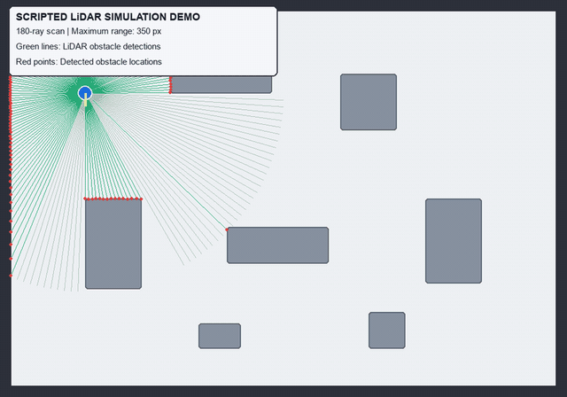
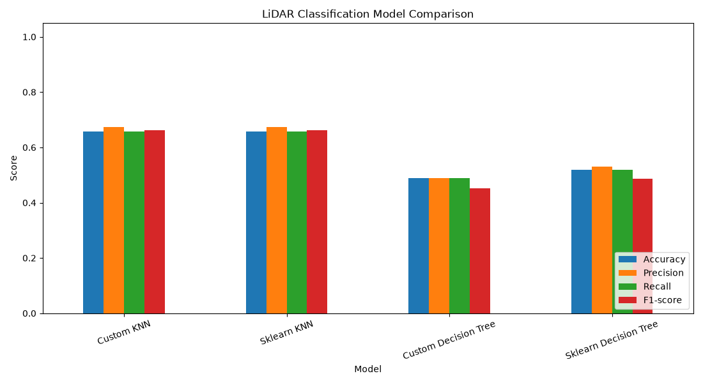
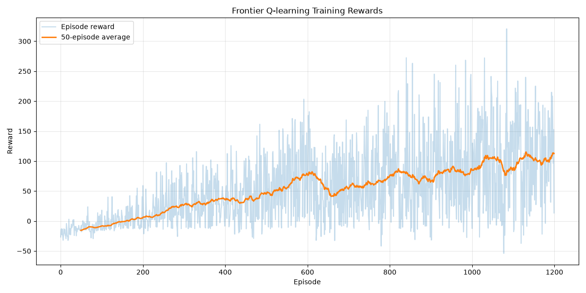
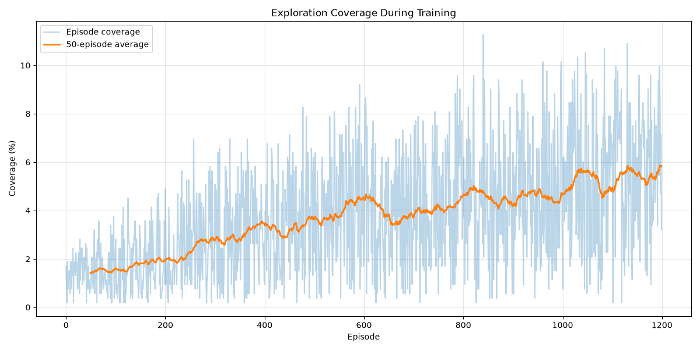
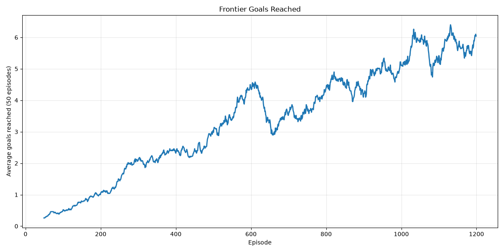

# Autonomous Indoor Exploration Robot Using LiDAR, Machine Learning and Reinforcement Learning

A simulation-based robotics project exploring indoor robot perception, autonomous navigation, and exploration using simulated LiDAR, machine learning, reinforcement learning, classical path planning, and fuzzy-logic safety control.

## 1. Project Overview

This project investigates different techniques used in autonomous indoor robotics through a collection of related simulation and experimental components.

A 2D indoor environment containing walls, furniture, and obstacles is used to study LiDAR-based sensing, synthetic scan classification, occupancy-grid mapping, and autonomous navigation.

The project is organized into four main components:

1. **Interactive LiDAR simulation:** A manually controlled robot demonstrating LiDAR sensing and visualization.
2. **Machine-learning perception:** Classification of synthetic LiDAR patterns using custom and scikit-learn models.
3. **Autonomous navigation:** Frontier-based exploration using BFS/A* path planning and fuzzy-logic safety control.
4. **Reinforcement learning:** Q-learning experiments for autonomous exploration.

These components are implemented as separate experiments. The manual LiDAR demonstration, synthetic perception experiment, Q-learning experiment, and final BFS/A* navigation evaluation should not be interpreted as one fully integrated pipeline.

**Project type:** Simulation-based robotics and AI  
**Language:** Python  
**Environment:** 2D indoor simulation

## 2. Technologies Used

| Technology | Purpose |
|---|---|
| Python | Core implementation |
| Pygame | 2D simulation and visualization |
| NumPy | Numerical operations |
| scikit-learn | Machine-learning baselines |
| Pandas | Data handling |
| Matplotlib | Experiment visualizations |
| pytest | Testing |

## 3. Project Components

### A. Interactive LiDAR Simulation

**Entry point:** `main.py`

This component provides a manually controlled robot in a simulated indoor environment.

The robot can move and rotate using keyboard inputs while simulated LiDAR rays measure distances to surrounding obstacles.

Features:
- 2D indoor environment containing walls and furniture.
- Ray-casting-based LiDAR simulation.
- 180 LiDAR rays.
- Maximum sensing range of 350 pixels.
- Real-time visualization of the robot, environment, and LiDAR scans.

**Controls**

| Key | Action |
|---|---|
| W | Move forward |
| S | Move backward |
| A | Move left |
| D | Move right |
| Q | Rotate left |
| E | Rotate right |
| ESC | Exit |

This is a manual sensing and visualization demonstration. It does not launch the autonomous navigation controller.

### B. Machine-Learning-Based LiDAR Perception

**Entry point:** `experiments/train_perception.py`

This component investigates whether machine-learning algorithms can classify object categories from simulated LiDAR distance patterns.

A synthetic dataset is generated using simulated object scenarios.

The four classes are:
- Person
- Box
- Shelf
- Free space

Features extracted from LiDAR scans include normalized distance readings, statistical measurements, sector-based features, hit masks, and distance differences.

**Models evaluated**
- Custom K-Nearest Neighbours.
- scikit-learn K-Nearest Neighbours.
- Custom Decision Tree.
- scikit-learn Decision Tree.
- Custom Random Forest.
- scikit-learn Random Forest.

**Evaluation setup:** Stratified 75:25 train-test split.

#### Perception results

| Model | Accuracy | Macro F1-score |
|---|---:|---:|
| Custom KNN | 67.60% | 68.17% |
| scikit-learn KNN | 67.60% | 68.17% |
| Custom Decision Tree | 78.90% | 78.79% |
| scikit-learn Decision Tree | 78.40% | 78.45% |
| Custom Random Forest | 78.00% | 78.00% |
| scikit-learn Random Forest | 78.60% | 78.41% |

The Decision Tree models achieved the highest accuracy in this experiment.

**Important limitation:** The dataset is synthetic and generated using isolated object scenarios. The models classify simulated LiDAR patterns; the reported results do not establish real-world object recognition or validated robot perception.

### C. Autonomous Indoor Navigation

**Entry point:** `experiments/evaluate_fuzzy_planners.py`

This is the main autonomous navigation experiment.

The robot explores the simulated environment using an occupancy grid and frontier-based navigation.

#### Occupancy-grid mapping

Each grid cell represents one of three states:

- `-1`: Occupied
- `0`: Unknown
- `1`: Free

#### Frontier-based exploration

A frontier is a free cell adjacent to an unknown cell. The robot identifies frontier locations and selects exploration targets to progressively discover unknown areas.

#### Path-planning algorithms

**Breadth-First Search (BFS)**
- Explores the grid level by level.
- Finds shortest paths in an unweighted grid.

**A* Search**
- Uses path cost and a heuristic to guide its search.
- Uses Manhattan distance as its heuristic.

#### Fuzzy-logic safety controller

The safety controller evaluates LiDAR distances in three directions:

- Front
- Left
- Right

Distances are classified using fuzzy membership categories:

- Near
- Medium
- Far

The controller can override unsafe movement decisions and includes obstacle-escape behaviour and temporary memory of rejected movement cells.

#### Navigation evaluation setup

| Parameter | Value |
|---|---|
| Algorithms | BFS and A* |
| Starting seeds | 42–71 |
| Episodes per algorithm | 30 |
| Total episodes | 60 |
| Traversable grid cells | 532 |
| Safety controller | Enabled |

Coverage is calculated using traversable free-space cells rather than the entire grid.

#### Final navigation results

| Metric | BFS | A* |
|---|---:|---:|
| True free-space coverage | 9.85 ± 2.65% | 9.57 ± 2.06% |
| Visited traversable cells | 52.40 ± 14.11 | 50.93 ± 10.94 |
| Frontiers reached | 4.67 ± 2.11 | 4.27 ± 1.72 |
| Average collisions | 0 | 0 |
| Replans | 14.07 ± 2.57 | 14.73 ± 1.53 |
| Safety override percentage | 4.59 ± 2.30% | 5.01 ± 1.62% |

Values are reported as mean ± standard deviation across 30 episodes per algorithm.

**Observations**
- Both approaches completed all 30 evaluated episodes without collisions.
- BFS achieved slightly higher mean exploration coverage than A*.
- The difference is small and does not establish statistical superiority.
- Exploration coverage remains limited, indicating scope for improving frontier selection and navigation efficiency.

Zero collisions in these experiments demonstrate performance only within the tested simulation scenarios. They do not guarantee real-world collision avoidance.

### D. Reinforcement Learning: Q-Learning

**Entry point:** `reinforcement_learning/train.py`

Q-learning is implemented as an additional exploration approach.

The agent learns action preferences using rewards and penalties for:
- Discovering new cells.
- Revisiting previously explored cells.
- Collisions.
- Movement costs.

The frontier-based Q-learning experiment is trained for 1,200 episodes. The learned Q-table is saved for later use.

Training outputs include:
- Q-table model.
- Episode rewards.
- Exploration coverage.
- Frontier goals reached.

Q-learning is an experimental component and is not the primary navigation method used in the final BFS/A* comparison.

## 4. Additional Integration Test

**Entry point:** `experiments/test_fuzzy_autonomous_navigation.py`

This script checks the integration of autonomous navigation and fuzzy safety control.

It runs:
- BFS with seeds 42, 43, and 44.
- A* with seeds 42, 43, and 44.
- A maximum of 150 steps per episode.

It reports visited cells, collisions, frontiers reached, safety checks, safety overrides, and replanning counts.

The previously completed integration test produced:
- 6 episodes.
- 900 total steps.
- 0 collisions.
- 779 safety checks.
- 40 safety overrides.

This is a short integration test, separate from the 60-episode navigation evaluation.

## 5. Project Structure

```text
robot_perception_learning/
├── main.py
├── config.py
├── requirements.txt
├── README.md
│
├── lidar/
│   ├── simulator.py
│   ├── ray_casting.py
│   └── dataset_generator.py
│
├── perception/
│   ├── knn.py
│   ├── decision_tree.py
│   ├── random_forest.py
│   ├── features.py
│   └── evaluation.py
│
├── reinforcement_learning/
│   ├── environment.py
│   ├── agent.py
│   ├── train.py
│   ├── visualize.py
│   ├── test_policy.py
│   └── evaluate_policy.py
│
├── navigation/
│   ├── grid_planner.py
│   └── autonomous_controller.py
│
├── safety/
│   └── fuzzy_controller.py
│
├── simulation/
│   └── renderer.py
│
├── experiments/
│   ├── train_perception.py
│   ├── test_grid_planner.py
│   ├── test_autonomous_navigation.py
│   ├── evaluate_planners.py
│   ├── test_fuzzy_safety.py
│   ├── test_fuzzy_autonomous_navigation.py
│   ├── diagnose_fuzzy_collision.py
│   └── evaluate_fuzzy_planners.py
│
├── tests/
├── notebooks/
├── results/
└── models/
```

## Demo

The following GIF shows a scripted movement sequence in the interactive 2D LiDAR simulation. It visualizes the robot's movement and simulated LiDAR scans; it is not a demonstration of the autonomous navigation planner.



## 5.1 Experimental Visualizations

### Perception Model Comparison



### Q-Learning Training Rewards



### Q-Learning Exploration Coverage



### Frontier-Based Exploration



---

## 6. Installation and Setup

### Prerequisites

- Python 3.10 or later.
- Git.
- FFmpeg (optional; required only to regenerate the demo GIF).

### Clone the repository

```bash
git clone https://github.com/irene-isreal/robot_perception_learning.git
cd robot_perception_learning
```

### Create a virtual environment

```bash
python3 -m venv .venv
```

Activate it on macOS/Linux:

```bash
source .venv/bin/activate
```

### Install dependencies

```bash
pip install --upgrade pip
pip install -r requirements.txt
```

## 7. Running the Experiments

Run commands from the project root with the virtual environment activated.

### A. Interactive manual LiDAR simulation

```bash
python main.py
```

**Expected output:** A Pygame window displaying the indoor environment, robot, and live LiDAR scans. Use the keyboard controls described earlier.

### B. Train and evaluate perception models

```bash
python -m experiments.train_perception
```

**Expected output:** Model evaluation metrics, including accuracy and classification performance. Check the `results/` and `models/` directories for generated artifacts.

### C. Train the Q-learning agent

```bash
python -m reinforcement_learning.train
```

**Expected output:** Training progress over 1,200 episodes, a saved Q-table at `models/frontier_q_table.pkl`, a CSV training log, and reward/coverage plots in `results/`.

### D. Test fuzzy safety

```bash
python -m experiments.test_fuzzy_safety
```

**Expected output:** Unit-test results for the fuzzy safety controller.

### E. Test autonomous navigation integration

```bash
python -m experiments.test_fuzzy_autonomous_navigation
```

**Expected output:** Results for six short BFS/A* integration episodes, including collision and safety metrics.

### F. Run the full BFS/A* evaluation

```bash
python -m experiments.evaluate_fuzzy_planners
```

**Expected output:** Results for 60 episodes, a mean and standard deviation comparison, and individual episode results saved to:

`results/fuzzy_planner_comparison.csv`

**Note:** This is a computationally longer experiment than the short integration test.

## 8. Limitations

1. The environment is a 2D simulation, not a physical robot.
2. LiDAR measurements are simulated rather than collected from physical sensors.
3. The perception dataset is synthetic and contains isolated object scenarios.
4. The perception experiment does not establish real-world object recognition performance.
5. Exploration coverage remains limited and requires improvement.
6. Q-learning performance is weaker than the current frontier-based navigation approach.
7. The system has not been tested on physical robotic hardware.
8. The evaluation covers a finite set of starting seeds and cannot establish performance in every possible environment.

## 9. Future Work

- Improve frontier selection and exploration coverage.
- Test larger and more complex indoor environments.
- Incorporate realistic LiDAR noise and sensor limitations.
- Evaluate perception models on real-world LiDAR datasets.
- Explore hybrid reinforcement-learning and classical planning approaches.
- Add dynamic obstacles and moving agents.
- Integrate ROS 2 and a higher-fidelity robotics simulator.
- Evaluate navigation on physical robotic hardware.

## 10. Research Direction

This project investigates several approaches to simulated autonomous indoor robotics, with particular emphasis on LiDAR-based perception, frontier-driven exploration, path planning, and safety-aware navigation.

It provides a foundation for further investigation into autonomous robotics, intelligent navigation, and safe exploration systems.

**Project status:** Simulation implementation and initial experimental evaluation completed. Improving exploration efficiency and real-world validation remain future work.